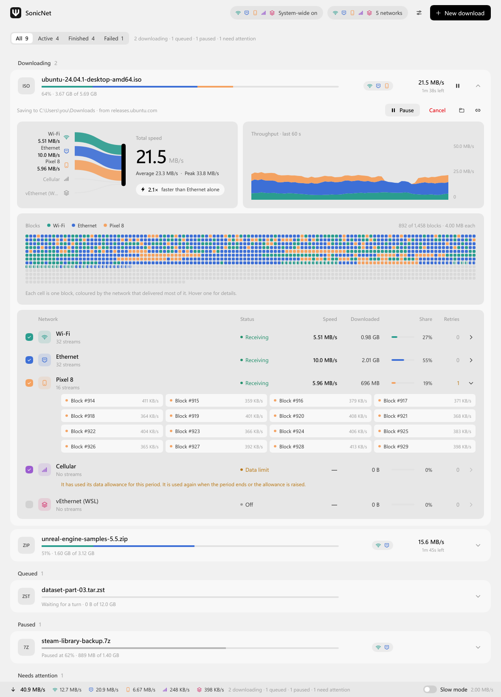
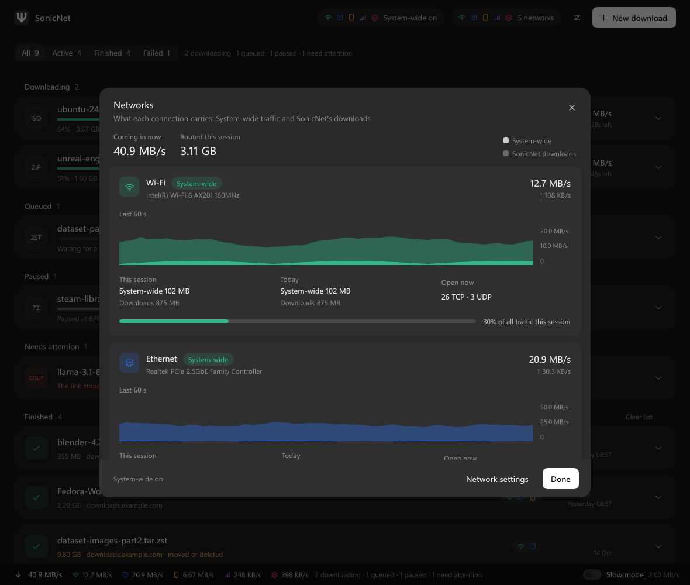
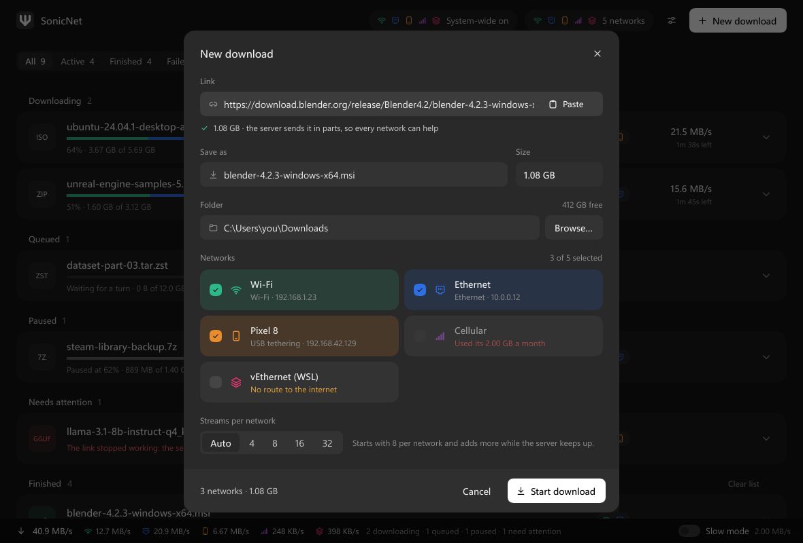
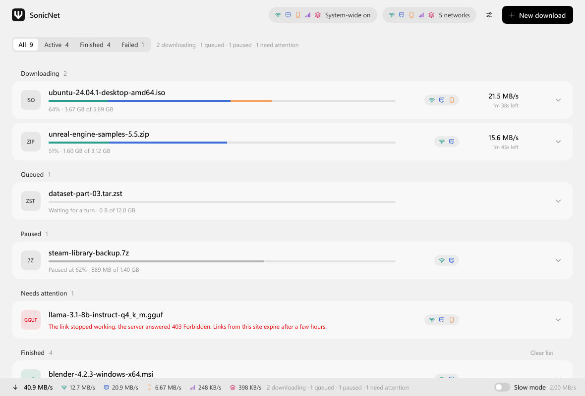
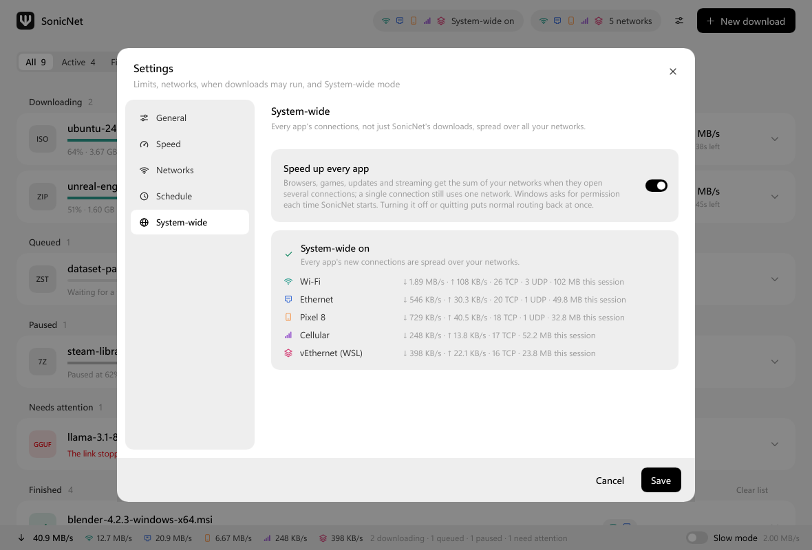

<p align="center">
  
</p>

<h1 align="center">SonicNet</h1>

<p align="center">
  <b>Combine every internet connection you have.</b><br>
  Wi-Fi + Ethernet + a phone + a second ISP: SonicNet uses all of them at once, for your downloads
  and for the whole PC.
</p>

<p align="center">
  <a href="#install">Install</a> ·
  <a href="#how-it-works">How it works</a> ·
  <a href="#privacy">Privacy</a> ·
  <a href="#build-from-source">Build</a> ·
  <a href="https://github.com/nettanvirdev/sonicnet/discussions">Discussions</a>
</p>

<p align="center">
  <picture>
    <source media="(prefers-color-scheme: dark)" srcset="app/snapshots/open-downloading-dark.png">
    
  </picture>
</p>

---

Most computers can reach the internet several ways at once (Wi-Fi, an Ethernet cable, a
tethered phone, a USB modem), but Windows sends everything through just one of them. SonicNet
puts all of them to work:

- **Downloads**: one file is split into blocks and fetched over every connection you pick, with
  many parallel streams on each. Faster connections automatically take more of the file.
- **System mode**: every app's traffic (browsers, games, Steam, video calls) is spread across
  your connections, each new connection going out the network that can carry it best.

Written in Rust, with a native [Slint](https://slint.dev) UI. Windows 10 and 11.

> **Speed only adds up across separate internet lines.** Two connections that end at the same
> router or the same ISP line share its speed. Separate lines, such as two ISPs, your router plus a
> phone, or fibre plus 5G, really add up. [How to check yours](docs/networks-on-windows.md).

## Features

**Downloads**
- Any number of networks at once, with up to 32 streams each, sized automatically to what the
  server, the network and the disk can take
- Faster networks take more of the file; slow blocks near the end are raced so one weak link can't
  hold up the finish
- Every response is verified (range, length, file version) before a byte is written, so a server
  that misbehaves can't corrupt your file
- Pause, resume, survive restarts and crashes; replace an expired link without losing progress
- Queue, speed limits (global and per network), Slow mode, data allowances per day / week / month,
  and a download schedule
- Turn networks on and off mid-download; ones that drop out come back on their own
- Browser extension for Chrome, Edge and Firefox hands downloads (with your sign-in) to the app

**System mode**
- One switch: on when SonicNet starts, off when it quits. Your normal internet comes back the
  instant the app closes, even if it crashes or is killed (measured ≈0.3 s)
- TCP and UDP, so HTTP/3 (QUIC), DNS and video calls work too
- Connections are placed by each network's measured speed, so a weak link gets a small share
  instead of slowing you down
- A site stays on one network for a couple of minutes, so logins don't see your address jump
- Your local network (printers, NAS, the router) is never touched

**See where your traffic goes**
- A live bar shows each network's speed, and the Networks page shows per-network charts, open
  connections, and totals for the session and the day

<table>
  <tr>
    <td></td>
    <td></td>
  </tr>
  <tr>
    <td></td>
    <td></td>
  </tr>
</table>

## Install

Download `SonicNet-Setup-<version>-x64.exe` from
[Releases](https://github.com/nettanvirdev/sonicnet/releases) and run it. It installs for your user
by default.

System mode needs administrator rights to add its network adapter, so Windows asks once each time
SonicNet starts. Say No and downloads still work; only System mode stays off. You can turn System
mode off for good in **Settings → System-wide**.

Then bring your second connection online: [getting two connections working at once on
Windows](docs/networks-on-windows.md) covers phone tethering, Wi-Fi plus Ethernet, and the Windows
setting that switches Wi-Fi off when a cable is plugged in.

### Browser extension

Build it from [`extension/`](extension/) and load it unpacked (store listings are coming). Once
it's installed, downloads in Chrome, Edge or Firefox go to SonicNet, and the browser keeps any
download SonicNet can't take. See [extension/README.md](extension/README.md).

## How it works

**Downloads.** SonicNet asks the server for the file's first bytes to learn its size, name and
version, and whether it can be fetched in parts. It cuts the file into 1–8 MiB blocks and opens
streams on every chosen network. Each stream is a socket pinned to one adapter (`IP_UNICAST_IF`),
so the traffic really leaves through that network, and each one pulls the next stretch of blocks
from a shared queue. Fast networks drain the queue quicker and so carry more of the file. Data
lands at its own offset in `<name>.sonic` and the file is renamed into place only once every block
is in.

**System mode.** A virtual adapter ([Wintun](https://www.wintun.net)) becomes the route for
internet traffic (`0.0.0.0/1` and `128.0.0.0/1`; your physical routes are left untouched). A
user-space TCP/IP stack accepts each connection your apps make, and SonicNet opens the real
connection to the same destination through a network chosen by measured capacity, then relays
the bytes. It is **not a VPN**: there is no server in between, and traffic goes straight from your
PC to the site over your own lines. The routes live only in memory and belong to the adapter, so
Windows removes them the moment SonicNet's helper process ends.

More detail: [ARCHITECTURE.md](ARCHITECTURE.md) and [docs/system-mode.md](docs/system-mode.md).

## Privacy

SonicNet has **no telemetry, no accounts, no update checks and no servers of its own**.

- **What it connects to:** the sites you download from, and (in System mode) wherever your apps
  connect. It makes one request on its own: when System mode starts, or a network first appears, it
  measures that network once by downloading for at most 3 seconds and 10 MB from
  `speed.cloudflare.com`. If Cloudflare refuses, it uses `ipv4.download.thinkbroadband.com` over
  plain HTTP, which only reveals that a SonicNet user is measuring. It never measures a tethered
  phone or a cellular connection.
- **What it stores, on your PC only, in `%APPDATA%\SonicNet`:**
  - settings, keyed by your network adapters' IDs;
  - your download list, history and saved progress, including each download's URL, in plain text.
    Signed links can contain access tokens, so treat the folder like your browser history;
  - per-network data usage.

  Browser cookies passed on by the extension are encrypted with Windows DPAPI, never logged, and
  deleted when the download finishes.
- **The browser extension** talks only to SonicNet on `127.0.0.1`. If you allow it in private or
  incognito windows, downloads from those windows are handed to SonicNet too and appear in its
  history.
- **Logs** go nowhere by default: the app keeps no log files.

## Build from source

Requirements: Windows 10/11, [Rust](https://rustup.rs) 1.88+ with the MSVC toolchain (Visual Studio
Build Tools, "Desktop development with C++").

```powershell
git clone https://github.com/nettanvirdev/sonicnet.git
cd sonicnet
cargo run --release -p sonicnet
```

System mode also needs `wintun.dll`. Download the official zip from
[wintun.net](https://www.wintun.net), check its SHA-256 against the site, and put
`bin\amd64\wintun.dll` and `LICENSE.txt` in `vendor/wintun/`; the build copies them next to the
executables. See [docs/system-mode.md](docs/system-mode.md).

To try the UI without touching your networks, run `cargo run -p sonicnet -- --demo`.

The installer needs [Inno Setup 6](https://jrsoftware.org/isdl.php): `pwsh packaging/windows/build.ps1`.

## Tests

```powershell
cargo test --workspace
cargo clippy --workspace --all-targets -- -D warnings
cargo fmt --all --check
```

About 460 tests, most of them end-to-end: real downloads against a local server that injects
faults (wrong ranges, stalls, cut connections, 429s, files that change mid-download), over fake
networks bound to `127.0.0.x`, with automatic checks that every finished file is byte-exact. No
internet or second adapter needed.

## Project layout

```
app/                 sonicnet.exe (Slint UI) and sonicnet-system.exe (the System mode helper)
crates/
  sonic-core         shared types and the UI↔backend protocol
  sonic-net          network adapters, and connections pinned to one of them
  sonic-engine       pure download logic: blocks, scheduling, stream counts, limits, schedules
  sonic-http         HTTP over one network: probing, verified range fetches, the staging file
  sonic-store        settings, history, saved progress, usage (%APPDATA%\SonicNet)
  sonic-bridge       the 127.0.0.1 endpoint the browser extension talks to
  sonic-manager      runs downloads: queue, streams per network, recovery, persistence
  sonic-system       System mode: Wintun adapter, TCP/UDP relay, network scheduler, helper
  sonic-testkit      test-only fault-injecting server and fake networks
extension/           browser extension (Chrome, Edge, Firefox)
packaging/           installer, manifest, icon generator
docs/                guides and design notes
```

## Contributing

Bug reports, network setups that misbehave, and pull requests are welcome. Start with
[CONTRIBUTING.md](CONTRIBUTING.md). For questions and ideas, use
[Discussions](https://github.com/nettanvirdev/sonicnet/discussions). Security issues: see
[SECURITY.md](SECURITY.md).

## Acknowledgements

- [Plexo](https://github.com/anmolkapil/plexo) (MIT, © 2026 Anmol Kapil) pioneered the multi-network
  downloader design that SonicNet reimplements in Rust. See [NOTICE](NOTICE).
- [Wintun](https://www.wintun.net) by WireGuard LLC provides the virtual adapter. Its signed DLL is
  shipped unmodified under its own licence. SonicNet is not affiliated with WireGuard.
- [Slint](https://slint.dev), [Tokio](https://tokio.rs), [hyper](https://hyper.rs),
  [rustls](https://github.com/rustls/rustls) and [ipstack](https://github.com/narrowlink/ipstack).

## License

[MIT](LICENSE)
